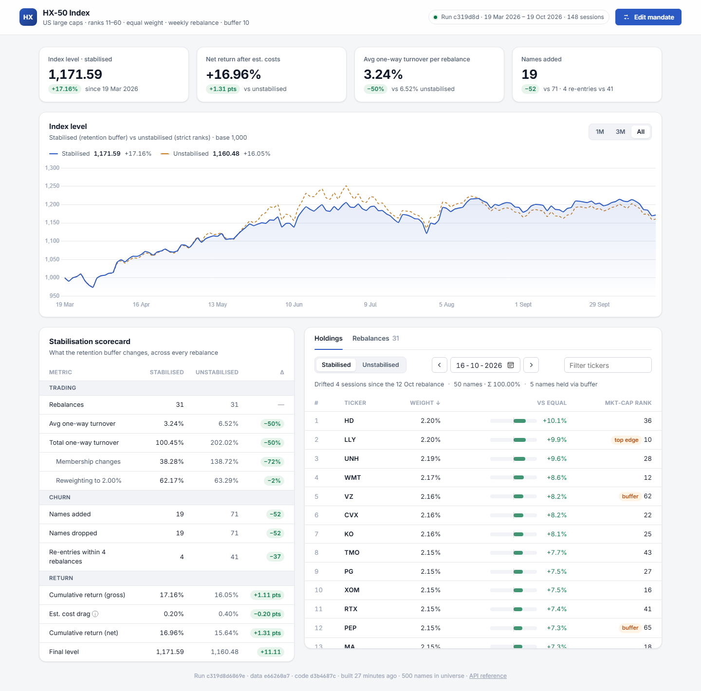

# HX-50 Index

Equal-weighted index of US large caps ranked **11–60 by market cap**, rebalanced weekly.
Two variants are built side by side from the same data:

| Variant | Rule |
|---|---|
| **Stabilised** (served by default) | Incumbents stay while ranked ≤ 70 (retention buffer); vacancies go to the best-ranked newcomers |
| **Unstabilised** | Exactly ranks 11–60 at every rebalance |

The dashboard compares them: index level, turnover attribution, churn, and return after estimated trading costs.



**New to the code?** Start with the [code walkthrough](docs/WALKTHROUGH.md): architecture, how a number flows
from CSV to screen, every UI view, the tests, and where to make common changes.

## Quick start

```powershell
python -m venv .venv
.venv\Scripts\Activate.ps1          # macOS/Linux: source .venv/bin/activate
pip install -e ".[dev]"

hx50 build                          # CSVs -> SQL model -> both variants -> data/hx50.db
hx50 serve                          # http://127.0.0.1:8000  (API reference at /docs)
pytest
```

Input data (`data/prices.csv`, `shares.csv`, `excluded_classes.csv`) is committed, so no download is needed.
To refresh it: `pip install -e ".[fetch]"`, then `hx50 fetch`, then `hx50 build`.

## Changing the mandate

```powershell
hx50 build --size 30 --exclude-top 20 --buffer 5
hx50 build --top-buffer 2           # tolerate incumbents rising to rank 9-10 (default 0 = strict)
hx50 build --cost-bps 20            # cost assumption used only for the net-return estimate
```

The dashboard's **Edit mandate** dialog does the same through `POST /api/rebuild`.
Rebuilds are atomic: an invalid mandate is rejected, and the previous index keeps serving until the new one is ready.

## Architecture

```
src/hx50/
├── domain/            Pure index logic. No I/O, no frameworks, fully deterministic.
│   ├── mandate.py       Mandate value object: rules + validation
│   ├── selection.py     SelectionRule strategies: StrictRule, BufferedRule
│   ├── portfolio.py     Weight arithmetic and Rebalance (turnover attribution)
│   ├── simulation.py    Day-by-day simulation -> IndexHistory
│   └── scorecard.py     Variant comparison metrics
├── pipeline/          Data in.
│   ├── model.sql        Cleaning, calendar, market cap, ranks, returns, rebalance dates
│   ├── market_data.py   CSV -> SQLite staging -> MarketData
│   ├── share_classes.py One line per company (dual-class de-duplication)
│   ├── fetch.py         Optional download from public sources
│   └── build.py         Orchestrates a build; atomic swap + reproducible run id
├── storage/           Data out: schema, writer, read-only repository
├── service.py         Application service used by every adapter (rebuild lock lives here)
├── api/               FastAPI adapter: app factory, routes, typed schemas
├── web/               Dashboard: HTML + CSS design tokens + ES modules (no build step)
└── cli.py             hx50 build | serve | dedupe | fetch
```

Dependencies point inwards: `api → service → pipeline/storage → domain`. The domain imports nothing from the
other layers, so the index rules can be read, tested and reasoned about on their own.

## API

| Endpoint | Returns |
|---|---|
| `GET /api/run` | Run manifest: run id, mandate, data and code fingerprints, period |
| `GET /api/levels?variant=&start=&end=` | Daily level, daily return, cumulative return, rebalance flag |
| `GET /api/composition?date=&variant=` | Holdings at that close (a non-trading date resolves to the prior trading day) |
| `GET /api/rebalances?variant=&start=&end=` | Each rebalance: added, dropped, membership and reweight turnover |
| `GET /api/scorecard` | Stabilised vs unstabilised comparison |
| `POST /api/rebuild` | Rebuild with `{size, exclude_top, buffer, top_buffer}` |

`variant` is `stabilised` (default) or `raw`. Errors: 404 for a date before the index starts, 409 when a rebuild
is already running, 422 for an invalid request or mandate, 503 when no index has been built.

## Methodology

See [NOTES.md](NOTES.md) for data sources, decisions and known limitations.
