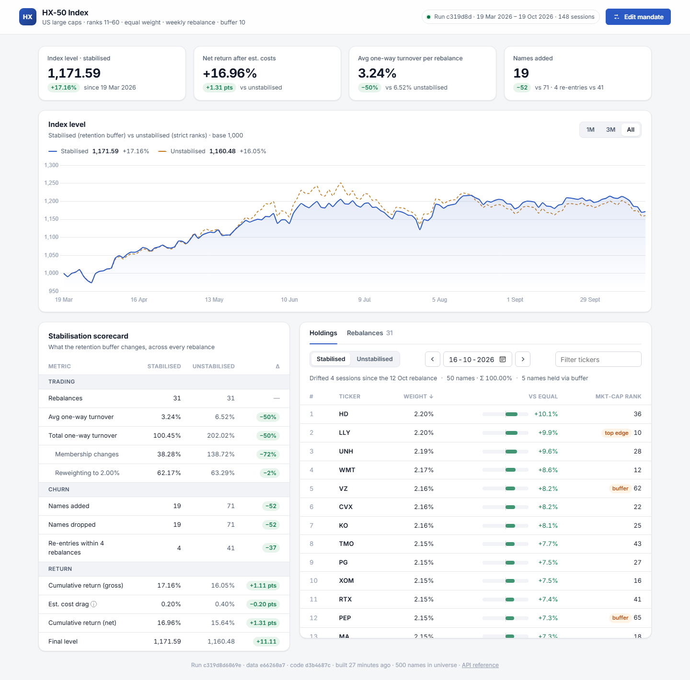
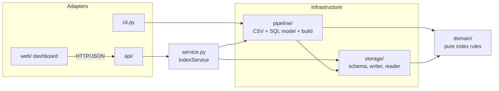
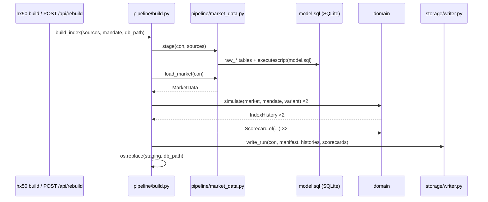
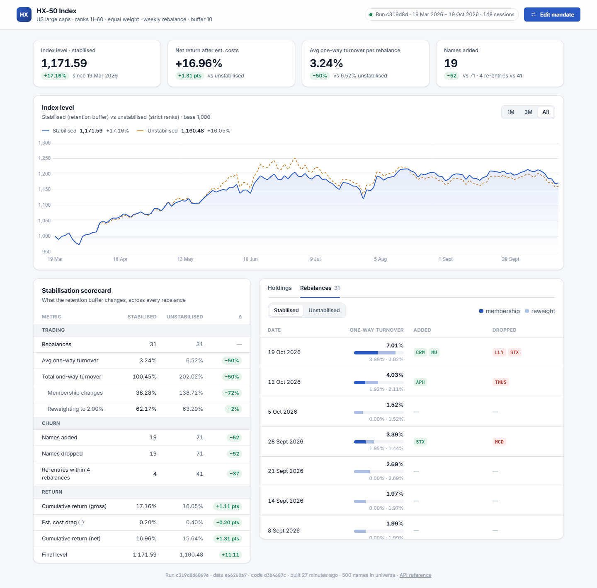
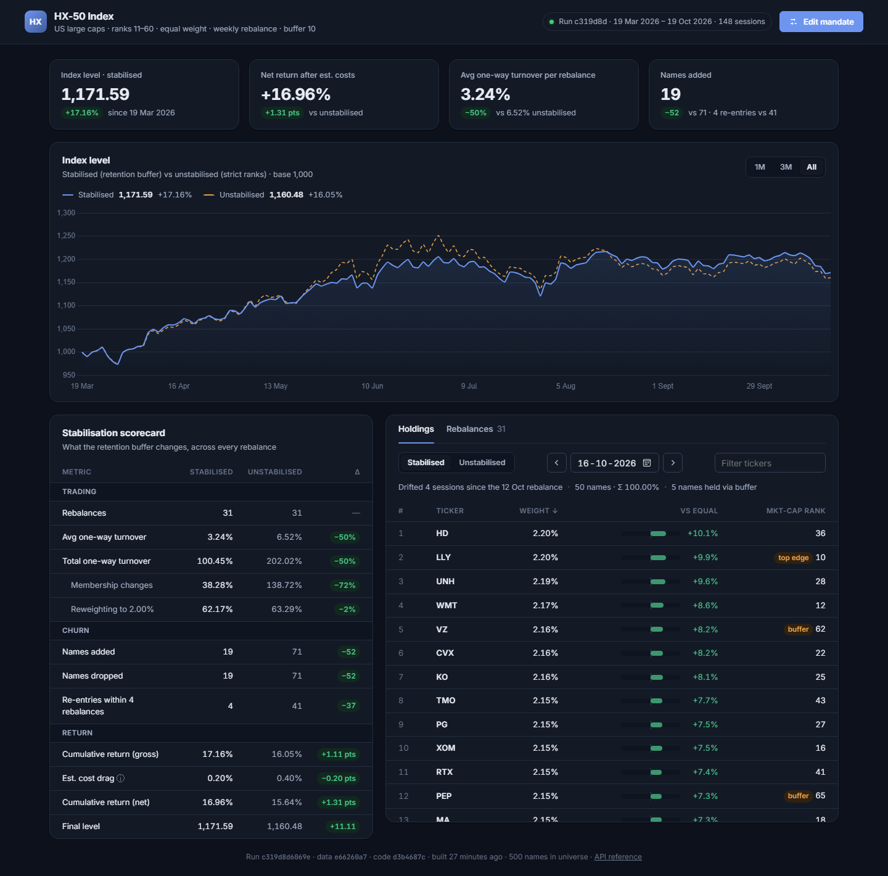
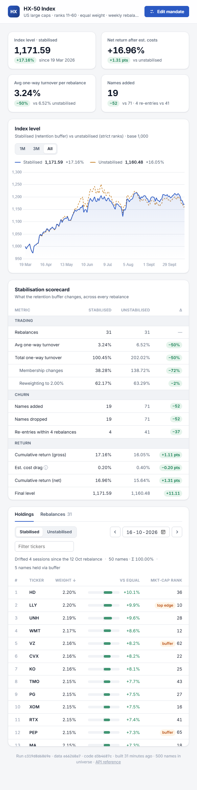

# HX-50 code walkthrough

A guided tour of the codebase: what each layer does, how a number travels from a CSV row to a pixel on the
dashboard, and where to make common changes. Read it top to bottom once; afterwards use the
[file map](#9-file-map) to jump straight to code.



---

## Contents
1. [The product in one minute](#1-the-product-in-one-minute)
2. [Architecture](#2-architecture)
3. [The domain core](#3-the-domain-core)
4. [The build pipeline](#4-the-build-pipeline)
5. [Storage](#5-storage)
6. [Service and API](#6-service-and-api)
7. [The dashboard](#7-the-dashboard)
8. [Tests](#8-tests)
9. [File map](#9-file-map)
10. [Common changes](#10-common-changes)

---

## 1. The product in one minute

HX-50 holds US large caps ranked **11–60 by market cap**, equally weighted, rebalanced on the first trading
day of every week. Two variants are built from identical data so the client can see what stabilisation buys:

| Variant | Selection rule | Result on the shipped data |
|---|---|---|
| **Stabilised** | Incumbents stay while ranked ≤ 70; vacancies go to the best-ranked newcomers | 3.24% turnover / rebalance, 19 names added |
| **Unstabilised** | Exactly ranks 11–60, every week | 6.52% turnover / rebalance, 71 names added |

```powershell
pip install -e ".[dev]"
hx50 build        # CSVs -> SQL model -> both variants -> data/hx50.db
hx50 serve        # dashboard at http://127.0.0.1:8000, API reference at /docs
pytest            # 41 tests
```

---

## 2. Architecture



**One rule holds the design together: dependencies point inwards.** `domain/` imports nothing from any other
layer: no pandas, no SQLite, no FastAPI. The index rules can therefore be read, unit-tested and reasoned about
without a database, and a change to the web layer can never silently change a number.

| Layer | Owns | Must not |
|---|---|---|
| `domain/` | Mandate, selection, portfolio maths, simulation, scorecard | do I/O or know about storage formats |
| `pipeline/` | Turning raw files into `MarketData`; running a build | contain index rules |
| `storage/` | Schema, persisting a run, read-only queries | compute anything |
| `service.py` | Use cases (rebuild under a lock, current mandate) | know about HTTP |
| `api/` | HTTP ↔ service translation, wire schemas, status codes | contain business logic |
| `web/` | Presentation | compute index numbers |

---

## 3. The domain core

`src/hx50/domain/` is roughly 300 lines and contains every rule that defines the index.

### 3.1 `Mandate`: the rulebook as a value object

```python
@dataclass(frozen=True)
class Mandate:
    size: int = 50
    exclude_top: int = 10
    buffer: int = 10
    top_buffer: int = 0
    base_level: float = 1000.0
    cost_bps: float = 10.0
    reentry_window: int = 4

    def is_retained(self, rank: int) -> bool:
        # Incumbents survive a wider band than newcomers need to enter; that gap is what dampens churn.
        return self.exclude_top - self.top_buffer < rank <= self.retention_floor
```

- **Frozen**: a mandate can't change halfway through a build, and because it's hashable the test fixtures can cache builds by mandate.
- **Validates itself** in `__post_init__`: an impossible mandate cannot be constructed, so no downstream code re-checks.
- **Derived properties** (`first_rank`, `last_rank`, `retention_floor`) give the bands names instead of repeating `exclude_top + size + buffer` in several places.

### 3.2 Selection: Strategy pattern

```python
class SelectionRule(Protocol):
    def select(self, ranks: Ranks, incumbents: Sequence[str]) -> list[str]: ...

class StrictRule:    # ranks first_rank..last_rank, nothing else
class BufferedRule:  # keep incumbents inside the retention band, fill vacancies by rank

def rule_for(variant: Variant, mandate: Mandate) -> SelectionRule
```

The old engine passed a `stabilised: bool` and branched inside one function. Now each variant is its own class,
and the simulation receives a rule without knowing which one it is. Adding a third variant (for example a
monthly-only buffer) means adding one class and one entry in `_RULES`. Nothing else changes.

### 3.3 Portfolio arithmetic

`portfolio.py` works on plain `ticker → weight` maps:

| Function | Meaning |
|---|---|
| `equal_weights(members)` | every member gets `1/N` |
| `portfolio_return(w, r)` | Σ wᵢ·rᵢ (a missing print counts as 0, and the next print carries the full move) |
| `drift(w, r, R)` | wᵢ·(1+rᵢ)/(1+R), so weights still sum to 1 |
| `Rebalance.between(drifted, target)` | turnover, split into **membership** and **reweight** |

```python
membership = 0.5 * (sum(target[t] for t in added) + sum(drifted[t] for t in dropped))
reweight   = 0.5 * sum(abs(target[t] - drifted[t]) for t in retained)
```

The 0.5 makes turnover one-way: selling 1% of X to buy 1% of Y counts as 1%, not 2%. The split explains why a
week with no membership change still trades: retained names have drifted off 2% and are reset.

### 3.4 Simulation: why the level can never jump

```python
for day in later_days:
    daily_return = portfolio_return(weights, day_returns)
    level *= 1.0 + daily_return                     # the only line that moves the level
    drifted = drift(weights, day_returns, daily_return)
    if day in market.rebalance_dates:
        members = rule.select(market.ranks_on(day), members)
        target = equal_weights(members)
        rebalances.append(Rebalance.between(day, drifted, target))
        weights = target                            # weights change, the level does not
    else:
        weights = drifted
```

- On a rebalance day the **old** holdings earn that day's return, and selection uses that close's ranks, so there is no look-ahead.
- Membership changes only swap weights, so a rebalance cannot create a jump in the level. The test suite proves this independently (§8).

The output is an immutable `IndexHistory(levels, holdings, rebalances)`. The simulation never touches a database.

### 3.5 Scorecard

`Scorecard.of(history, mandate)` reduces a history to the comparison metrics. Two of them deserve a note:

- **Cost drag** = `2 × total one-way turnover × cost_bps / 10,000`. The factor of 2 counts both sides of each trade.
  The drag is subtracted once at the end, a first-order estimate that ignores compounding.
- **Re-entries** count names bought back within `reentry_window` rebalances of being dropped. This is the
  "yo-yo" churn the buffer exists to remove: 4 stabilised vs 41 unstabilised.

---

## 4. The build pipeline



### 4.1 `model.sql`: all data shaping in one place

| Table | Built from | Purpose |
|---|---|---|
| `prices` | `raw_prices` | drop non-positive prices, one row per (date, ticker) |
| `calendar` | `prices` | a trading day needs ≥ 50% of the usual cross-section |
| `market_cap` | `prices` × `raw_shares` | split-adjusted close × shares, secondary share classes excluded |
| `ranked` | `market_cap` | `ROW_NUMBER()` per date, ticker as the tie-break, so ranks are deterministic |
| `returns` | `prices` | `LAG` over each ticker's own rows, so a gap is spanned (forward fill) |
| `rebalance_dates` | `calendar` | first trading day of each Monday-based week (a holiday moves it to Tuesday) |

### 4.2 Atomic, reproducible builds

```python
staging = db_path.with_name(db_path.name + ".building")
try:
    with closing(sqlite3.connect(staging)) as con:
        ...                                   # stage, simulate, write
except BaseException:
    staging.unlink(missing_ok=True)           # a failed build leaves no trace
    raise
os.replace(staging, db_path)                  # readers see the old run or the new one, never half of one
```

The **run id** is `sha256(mandate + data fingerprint + code fingerprint)[:12]`. The same inputs always produce
the same id. Rebuilding the defaults after a 30-name experiment gives back `c319d8d6069e`, which makes any
published number traceable to its exact inputs.

### 4.3 Share-class de-duplication

Yahoo reports a company's total share count on every listed class, so GOOGL and GOOG would each be valued at
Alphabet's full cap. `share_classes.py` groups tickers with identical share counts and keeps the higher-priced
class. `hx50 dedupe` regenerates `data/excluded_classes.csv`.

---

## 5. Storage

`storage/schema.sql` declares every published table with types and primary keys:

| Table | Key | Content |
|---|---|---|
| `run` | `run_id` | manifest: mandate (JSON), fingerprints, period, runtime versions |
| `index_level` | (variant, date) | level, daily return, cumulative return, rebalance flag |
| `holding` | (variant, date, ticker) | weight at that close, market-cap rank |
| `rebalance` | (variant, date) | added, dropped, membership and reweight turnover |
| `scorecard` | variant | the comparison metrics |

`IndexReader` is a small repository. **Each call opens its own read-only connection** (`?mode=ro`), so a
rebuild swapping the file never affects a request already in flight, and the API can't write to the database.
It returns domain objects (`LevelPoint`, `Rebalance`, `Scorecard`), not raw rows.

---

## 6. Service and API

### 6.1 `IndexService`

```python
def rebuild(self, **rule_changes):
    if not self._rebuild_lock.acquire(blocking=False):
        raise RebuildInProgress("a rebuild is already running")
    try:
        mandate = replace(self.current_mandate(), **rule_changes)
        return build_index(self._settings.sources, mandate, self._settings.db_path)
    finally:
        self._rebuild_lock.release()
```

- **Non-blocking lock**: a double click gets an immediate 409 instead of a queued second build.
- `dataclasses.replace` carries over rules the request didn't mention (base level, cost) and re-runs validation.

### 6.2 API layer

| File | Role |
|---|---|
| `api/app.py` | `create_app(settings)` factory: dependency injection, error mapping, static UI |
| `api/routes.py` | thin handlers: parse → call service → convert to schema |
| `api/schemas.py` | Pydantic wire contract, separate from domain types |

Errors are mapped from domain exceptions to HTTP status codes **in one place**:

```python
ERROR_STATUS = {InvalidMandate: 422, InsufficientUniverse: 422, RebuildInProgress: 409, IndexNotBuilt: 503}
```

One gotcha is documented in the code: FastAPI flattens dataclasses with `asdict()`, which would drop computed
properties such as `turnover` or `rebalance_day`. Routes therefore convert explicitly with
`Schema.model_validate(obj)`.

| Endpoint | Returns |
|---|---|
| `GET /api/run` | manifest + mandate |
| `GET /api/levels?variant=&start=&end=` | daily levels |
| `GET /api/composition?date=&variant=` | holdings at a close (non-trading date → previous trading day) |
| `GET /api/rebalances?variant=` | rebalance history |
| `GET /api/scorecard` | stabilised vs unstabilised |
| `POST /api/rebuild` | `{size, exclude_top, buffer, top_buffer}` → new run + scorecard |

---

## 7. The dashboard

Plain HTML, CSS and ES modules, with no build step. Chart.js is the only library.

```
web/
├── index.html              semantic layout, dialog, ARIA roles
└── assets/
    ├── styles.css          design tokens (colour, radius, shadow) + light/dark themes
    └── js/
        ├── main.js         controller: owns state, fetches, wires views
        ├── api.js          typed fetch client, normalises FastAPI errors
        ├── dom.js          html`` template that escapes every value by default
        ├── format.js       cached Intl formatters (%, pts, dates in UTC)
        └── views/          one file per panel; views receive data and never fetch
```

**Pattern:** `main.js` is the only module that holds state or calls the API. Views are functions of their
input, so each panel can be read on its own, and a redesign can't break data loading.

### 7.1 Overview: KPIs, chart, scorecard


- **KPI tiles** compare stabilised with unstabilised. Badge colour answers "is this good for the client?":
  lower turnover is green, and so is higher return.
- **Chart**: both variants with 1M / 3M / All ranges. The tooltip shows the spread and marks rebalance days.
- **Scorecard**: grouped into Trading / Churn / Return, with a Δ column (relative change for turnover,
  percentage points for returns). Hover *Est. cost drag* for its formula.

### 7.2 Holdings

The holdings table (right of the overview above) shows the composition at any close:

- **Date stepper** moves between trading days. A weekend date resolves to the prior session and says so.
- **Status line**: rebalance day (weights reset to 2%) or "Drifted N sessions since the last rebalance".
- **vs equal** uses a diverging bar centred on 2%, so drift direction and size read at a glance.
- **Badges** flag names held *only* because of the buffer (`buffer`, rank 61–70) or the top edge.
- Columns sort on click, and the ticker filter narrows rows without a refetch.

### 7.3 Rebalances



Newest first. Each row splits turnover into **membership** (dark) and **reweight** (light), with added and
dropped tickers as chips. Clicking a row opens the holdings right after that rebalance.
Deep link: `/#view=rebalances`.

### 7.4 Mandate editor

**Edit mandate** opens a dialog that validates as you type, using the same rules as the server, and previews the
rank band ("Holds ranks 11–60… incumbents stay until rank 70"). Submitting calls `POST /api/rebuild`. While it
runs, the current index keeps serving. Server errors appear inline in the dialog.

### 7.5 Dark mode and narrow screens

Themes are only token overrides under `prefers-color-scheme: dark`. The chart reads the same tokens and redraws
when the OS theme changes.

| Dark | Narrow viewport |
|---|---|
|  |  |

---

## 8. Tests

```
tests/
├── synthetic.py       random-walk market with a Monday holiday and 60 missing prices
├── conftest.py        session-cached builds keyed by Mandate, plus SQL helpers
├── test_domain.py     pure unit tests: mandate, selection, portfolio maths, re-entries, no-jump
├── test_pipeline.py   end-to-end properties of a full build
└── test_api.py        HTTP contract, error codes, live rebuild, static UI
```

The most important checks:

| Test | Guarantee |
|---|---|
| `test_level_matches_an_independent_units_based_recomputation` | Recomputes the level from *units held × price*, with no weights or returns. It must equal the engine's level, which proves rebalances cause no jumps. |
| `test_unstabilised_is_exactly_the_entry_band_on_every_rebalance` | The raw variant is precisely ranks 11–60 |
| `test_stabilised_members_never_fall_below_the_retention_floor` | The buffer is never exceeded |
| `test_rebuild_is_deterministic_and_failure_keeps_previous_database` | Same inputs give the same run id; a failed build leaves the database byte-identical |
| `test_split_restated_history_leaves_the_index_unchanged` | A 2:1 split restatement changes nothing |
| `test_secondary_share_classes_are_never_ranked_or_held` | One line per company |

The rewrite was also checked against the original implementation: all 296 index levels and 14,800 holding
weights match to within floating-point noise (max difference about 1e-12).

---

## 9. File map

| Path | One-line purpose |
|---|---|
| `src/hx50/domain/mandate.py` | Rules + validation |
| `src/hx50/domain/selection.py` | `StrictRule`, `BufferedRule`, `rule_for` |
| `src/hx50/domain/portfolio.py` | Weight maths, `Rebalance` turnover attribution |
| `src/hx50/domain/simulation.py` | `MarketData` → `IndexHistory` |
| `src/hx50/domain/scorecard.py` | Comparison metrics |
| `src/hx50/pipeline/model.sql` | Cleaning, calendar, market cap, ranks, returns, rebalance dates |
| `src/hx50/pipeline/market_data.py` | CSV staging, `load_market` |
| `src/hx50/pipeline/build.py` | Build orchestration, atomic swap, run id |
| `src/hx50/pipeline/share_classes.py` | Dual-class de-duplication |
| `src/hx50/pipeline/fetch.py` | Optional data download |
| `src/hx50/storage/schema.sql` | Published tables |
| `src/hx50/storage/writer.py` / `reader.py` | Persist a run / read-only repository |
| `src/hx50/service.py` | `IndexService`: rebuild lock, current mandate |
| `src/hx50/api/app.py` / `routes.py` / `schemas.py` | Factory + errors / handlers / wire contract |
| `src/hx50/web/` | Dashboard |
| `src/hx50/cli.py` | `hx50 build | serve | dedupe | fetch` |
| `src/hx50/config.py` | `Settings` (env: `HX50_DATA_DIR`, `HX50_DB`) |

---

## 10. Common changes

| I want to… | Change |
|---|---|
| Rebalance monthly | `rebalance_dates` in `pipeline/model.sql`: group by `strftime('%Y-%m', date)` |
| Add a third variant | a new `SelectionRule` class + a `Variant` member + an entry in `_RULES` (`domain/selection.py`) |
| Change default rules | field defaults on `Mandate` (`domain/mandate.py`) |
| Use a different cost assumption | `hx50 build --cost-bps 20` |
| Add a scorecard metric | a field on `Scorecard`, a column in `storage/schema.sql`, the writer tuple, `ScorecardOut`, and a row in `views/scorecard.js` |
| Add an endpoint | a reader method in `storage/reader.py`, a schema in `api/schemas.py`, a handler in `api/routes.py` |
| Restyle the UI | tokens at the top of `web/assets/styles.css` |
| Point at other data | `HX50_DATA_DIR=...` or `HX50_DB=...` |
